# readme-flow-svg

Create an animated workflow for your GitHub README.

[Open the generator](https://infinuts.github.io/readme-flow-svg/)



Enter three to six steps and watch a dot or file move through them. The preview updates as you edit. You can change the labels, reorder stages, adjust the loop duration, and choose a light, dark, or terminal theme.

The generator runs in your browser. You don't need an account or your own deployment.

## Add a workflow to your README

1. Open the generator and choose a preset: File processing, API request, or Deployment.
2. Edit the steps and choose how the animation looks.
3. Download `workflow.svg` and put it beside your repository's README.
4. Paste the copied Markdown: ``.

The SVG contains its own animation and icons. It doesn't need scripts, remote fonts, or an image service.

Use the link button above the preview to share your settings. Opening that URL recreates the workflow in the editor. Your most recent settings are also saved in your browser.

GitHub Pages can't generate images from URL parameters. Shared links open the editor; the image in your README is the SVG you downloaded.

## Run locally

Download or clone this repository and open `index.html` in your browser. The editor works without a server.

To change the source, use Node.js 22 or newer. You don't need `npm install`.

```sh
npm run build
npm run dev
```

Open http://127.0.0.1:4173. After editing the source, rebuild and refresh. The build also updates `src/browser.js`, which lets `index.html` work when opened directly.

```sh
npm test
```

## Deploy a fork

The public generator is available at the link above. If you want to host your own copy:

1. Push this project to your GitHub repository’s `main` branch.
2. In Settings → Pages → Build and deployment, select GitHub Actions.
3. The included `.github/workflows/pages.yml` tests, builds, and deploys the site on each push to `main`. You can also run it manually from the Actions tab.

All asset paths are relative, so both `username.github.io` and `username.github.io/readme-flow-svg/` work. You can also host the contents of `dist/` on any static host.

## Contribute

Presets, palettes, and stage icons live in `src/svg.js`. The editor is in `src/app.js`, with its layout and styles in `index.html` and `src/style.css`.

To add a theme, define its colors in `THEMES` and add a matching picker in `index.html` and `src/style.css`. Run `npm run build` to regenerate the browser script and example SVGs. The preview and downloads use the same renderer.

Keep exported SVGs self-contained. Preserve XML escaping and reduced-motion support, and avoid scripts, foreign objects, or external assets.

Inspired by [Readme Typing SVG](https://github.com/DenverCoder1/readme-typing-svg) and [archgram](https://github.com/byAbas/archgram). Outline icons are adapted from [Tabler Icons](https://tabler.io/icons) under the MIT license.

## License

MIT. See [LICENSE](./LICENSE).
