#  readme-flow-svg

Create an animated workflow for your GitHub README.

[Open the generator](https://readme-flow-svg.vercel.app/) · [GitHub Pages mirror](https://infinuts.github.io/readme-flow-svg/)

[](https://readme-flow-svg.vercel.app/r)

Enter three to twelve steps and watch a dot, file, or another icon move through them. Add a title and subtitle, arrange the cards in rows or columns, and connect them to show branches, merges, and review loops. The preview updates as you edit.

Choose Light, Dark, Terminal, GitHub, Ocean, or Sunset, or make a custom theme with your own colors. The moving element picker includes a rocket, package, code, spark, heart, and lightning bolt. The dot has a subtle pulse, and movement eases between stages.

The generator runs in your browser. You don't need an account or your own deployment.

## Add a workflow to your README

1. Open the generator and choose a preset: File processing, API request, Deployment, Data pipeline, Authentication, AI inference, Release pipeline, Review loop, or Parallel checks.
2. Edit the steps and choose how the animation looks.
3. Click Copy Markdown and paste the result into your README. The image URL generates your SVG directly, so you don't need to upload a file.

For a file that lives in your own repo, choose “File in your repo”, download `workflow.svg`, and put it beside the README. That mode copies ``.

Adding a step opens an icon picker. Click the icon beside any existing step to change it. Each icon stays with its step when you reorder the workflow.

Choose Custom in the theme picker to edit the background, cards, labels, accent, borders, active stages, step numbers, and connections. Your palette and moving element are included in downloaded SVGs and shared editor links.

## Build a larger workflow

Use **Title & layout** to add a heading and subtitle. Horizontal and vertical layouts keep a single sequence. Snake wraps the sequence back and forth across rows; Grid fills each row from left to right. Choose two to six steps per row.

Under **Connections & branches**, switch to Custom connections and choose the start and end of each line. Add labels such as “Success”, “Retry”, or “Needs review”. Connections use zero-based step indices in the API, while the editor shows step names and numbers. Reordering a step preserves its connections; removing it removes its attached lines. You can leave steps disconnected.

Rounded paths and square elbows route around cards. Direct lines join endpoints without avoiding cards. Choose solid, dashed, or dotted lines, change their width, and toggle arrowheads. Use the up/down buttons to change connection order. Connections animate in list order, so the diagram illustrates a workflow rather than simulating task execution.

Under **Appearance & spacing**, change the font, space between cards, corner radius, and moving element size. Hide step numbers or export with a transparent background. Loops can run for 2–30 seconds.



The SVG contains its own animation and icons. It doesn't need scripts, remote fonts, or an image service.

Use the link button above the preview to share your settings. Opening that URL recreates the workflow in the editor. Your most recent settings are also saved in your browser.

Vercel hosts the editor and image API. The editor is also available on GitHub Pages. Shared editor links reopen the controls; image links return `image/svg+xml`.

## Image URLs

```markdown
[](https://readme-flow-svg.vercel.app/r)
```

`steps` accepts semicolon-separated labels or a JSON array. The generator encodes all options for you, including labels containing semicolons.

| Options | Values |
| --- | --- |
| `title`, `subtitle` | Up to 80 and 140 characters |
| `layout`, `columns` | `horizontal`, `vertical`, `snake`, or `grid`; 2–6 columns |
| `connectionMode`, `connections` | `sequential` or `custom`; up to 24 `{from, to, label}` objects |
| `routing`, `lineStyle` | `curved`, `elbow`, or `straight`; `solid`, `dashed`, or `dotted` |
| `lineWidth`, `arrows` | 1–4; `true` or `false` |
| `spacing`, `radius` | 32–120 pixels; 0–24 pixels |
| `font`, `showNumbers`, `transparent` | `sans`, `mono`, or `serif`; boolean flags |
| `duration`, `travelerSize` | 2–30 seconds; 0.6–1.8 scale |
| `preset`, `theme`, `traveler`, `icons`, `customTheme` | Supported names from `/options`, an icon array, and a palette object |

For example: `/svg?preset=release&title=Release%20pipeline&layout=snake&columns=3&theme=github`. Existing links keep their original straight-line appearance when no new options are set.

The `/r` route redirects to this repository. Git.io stopped accepting new short links in 2022, so a new git.io alias isn't available. [GitHub's announcement](https://github.blog/changelog/2022-01-11-git-io-no-longer-accepts-new-urls/).

## Generate with AI

The [readme-flow-svg skill](./skills/readme-flow-svg/SKILL.md) teaches an agent how to choose steps and return an SVG or hosted Markdown embed. The repo includes setup for Codex and Claude Code:

| Harness | Instructions | Skill | MCP configuration |
| --- | --- | --- | --- |
| Codex | [AGENTS.md](./AGENTS.md) | [.agents/skills/readme-flow-svg](./.agents/skills/readme-flow-svg/SKILL.md) | [.codex/config.toml](./.codex/config.toml) |
| Claude Code | [CLAUDE.md](./CLAUDE.md) | [.claude/skills/readme-flow-svg](./.claude/skills/readme-flow-svg/SKILL.md) | [.mcp.json](./.mcp.json) |

Open the checkout in either harness, trust the project or approve its MCP connection when prompted, and ask it to generate a README workflow. Invoke `$readme-flow-svg` in Codex or `/readme-flow-svg` in Claude Code. No API key or service login is required.

To use the skill in another project, copy the skill folder and MCP configuration into that project. For user-wide skills, use `~/.agents/skills/` for Codex or `~/.claude/skills/` for Claude Code. See the official [Codex skill locations](https://developers.openai.com/codex/skills) and [Claude skill locations](https://code.claude.com/docs/en/skills).

Edit `skills/readme-flow-svg/SKILL.md` and run `npm run sync:skills` to update both harness copies. `npm test` checks that they stay in sync.

The hosted MCP endpoint is:

```text
https://readme-flow-svg.vercel.app/mcp
```

It exposes `generate_workflow` and `list_options` through public Streamable HTTP. Any compatible MCP client can connect without OAuth. Both tools generate output or list settings; they do not edit files or publish changes.

For a local stdio server that doesn't require a service login, clone the repository and run:

```sh
npm ci
npm run mcp
```

Example stdio client configuration (replace the path with your checkout):

```json
{
  "mcpServers": {
    "readme-flow-svg": {
      "command": "node",
      "args": ["/absolute/path/readme-flow-svg/mcp/stdio.mjs"]
    }
  }
}
```

Without MCP, POST a JSON configuration to `/generate` on the image service. It returns `svg`, `image_url`, `markdown`, `editor_url`, and the normalized `config`. GET `/options` lists supported presets, palettes, and icons. The service is stateless; workflow settings are visible in shared URLs.

## Run locally

Download or clone this repository and open `index.html` in your browser. The editor works without a server.

To change the editor, use Node.js 22 or newer. Its static build doesn't need installed dependencies. Tests, the image service, and MCP use the packages installed by `npm ci`.

```sh
npm run build
npm run dev
```

Open http://127.0.0.1:4173. After editing the source, rebuild and refresh. The build also updates `src/browser.js`, which lets `index.html` work when opened directly.

```sh
npm ci
npm test
```

## Deploy a fork

The public generator is available at the link above. If you want to host your own copy:

1. Push this project to your GitHub repository’s `main` branch.
2. In Settings → Pages → Build and deployment, select GitHub Actions.
3. The included `.github/workflows/pages.yml` tests, builds, and deploys the site on each push to `main`. You can also run it manually from the Actions tab.

All asset paths are relative, so both `username.github.io` and `username.github.io/readme-flow-svg/` work. You can also host the contents of `dist/` on any static host.

For the editor, SVG API, and HTTP MCP together, import the repo into Vercel. The included `vercel.json` defines the build, static output, and API routes. The main repo is connected to Vercel, so pushes deploy automatically. Forks can use the public image service or replace `SERVICE_URL` in `src/links.js` with their own production domain and update the MCP configurations and source skill.

The HTTP handler lives in `server/handler.js`, with Vercel adapters in `api/`. `npm run build:api` creates and verifies a standalone API bundle in `.api-build/` without replacing the static build. Vercel builds the adapters directly. No `.openai` files are needed; local deployment metadata and environment files are ignored by Git.

## Contribute

Presets, palettes, and icons live in `src/svg.js`. Add moving elements to `TRAVELERS`. The editor is in `src/app.js`, with its layout and styles in `index.html` and `src/style.css`.

To add a theme, define its colors in `THEMES` and its name in `THEME_LABELS`. The theme picker updates automatically. Run `npm run build` to regenerate the browser script and example SVGs. The preview and downloads use the same renderer.

Keep exported SVGs self-contained. Preserve XML escaping and reduced-motion support, and avoid scripts, foreign objects, or external assets.

Inspired by [Readme Typing SVG](https://github.com/DenverCoder1/readme-typing-svg) and [archgram](https://github.com/byAbas/archgram). Outline icons are adapted from [Tabler Icons](https://tabler.io/icons) under the MIT license.

## License

MIT. See [LICENSE](./LICENSE).
