<p align="center"></p>

# readme-flow-svg

Animated SVG workflows for GitHub READMEs, made in your browser.

[](./LICENSE)
[](https://github.com/infinuts/readme-flow-svg/stargazers)
[](https://github.com/infinuts/readme-flow-svg/actions/workflows/ci.yml)
[](https://github.com/infinuts/readme-flow-svg/actions/workflows/pages.yml)

[Open the editor](https://readme-flow-svg.vercel.app/) · [Examples](./examples/README.md) · [Report a bug](https://github.com/infinuts/readme-flow-svg/issues/new?template=bug_report.yml)



This demo was generated with the project's own `generate_workflow` tool. No account, subscription, tracking, or analytics.

## Quick start

1. [Open the editor](https://readme-flow-svg.vercel.app/) and choose a preset or gallery example.
2. Edit the steps, icons, and appearance. The preview updates as you work.
3. Copy Markdown for a hosted image, or download `workflow.svg` and choose **File in your repo**.

```markdown

```

For a hosted image, paste a URL directly:

```markdown

```

The editor runs entirely in your browser, including SVG downloads. Hosted images use the existing public SVG service and include the workflow settings in their URL. Optional Google Fonts requests send the font family and weight, without workflow text. Built-in fonts and downloaded SVGs work offline. Settings are saved on your device.

## Features

- Three to twelve steps, with stage icons, titles, and subtitles.
- Horizontal, vertical, snake, and grid layouts; drag cards or move them with the keyboard.
- Labeled branches, merges, loops, and configurable connection styles.
- Six SVG palettes, custom colors, and eight moving elements.
- Self-contained SVGs with CSS animation and reduced-motion support.
- Hosted embeds, local downloads, editable links, and Markdown alt text.
- A responsive editor with system, light, and dark page appearance.
- REST and MCP interfaces using the same renderer as the editor.

Page appearance is independent of SVG appearance. Animation follows connection order; it does not simulate concurrent execution.

## URL parameters

Image links use `/svg`; editor links use `/?` with the same parameters. Existing formats are unchanged.

| Parameter  | Example                    | Meaning                                |
| ---------- | -------------------------- | -------------------------------------- |
| `steps`    | `Upload;Validate;Download` | 3–12 labels; JSON arrays also accepted |
| `preset`   | `deploy`                   | Starting workflow                      |
| `theme`    | `github`                   | SVG palette                            |
| `traveler` | `file`                     | Moving element                         |
| `duration` | `8`                        | Complete loop, 2–30 seconds            |
| `layout`   | `snake`                    | Horizontal, vertical, snake, or grid   |
| `columns`  | `3`                        | 2–6 columns in a wrapped layout        |
| `title`    | `Release%20pipeline`       | Optional heading                       |

Use the editor to encode punctuation, custom connections, and palettes correctly. [Full parameter reference](./docs/URL-PARAMETERS.md) · [Supported options](https://readme-flow-svg.vercel.app/options)

## Run locally

Open the checked-in `index.html` directly, or use Node.js 22+:

```sh
npm ci
npm run build
npm run dev
```

Visit `http://127.0.0.1:4173`. Rebuild after changing source files. The editor uses vanilla JavaScript and CSS; server dependencies are kept out of the static editor except the browser font engine.

```sh
npm run lint
npm run type-check
npm run format:check
npm test
npm run build
npm run build:api
```

[Development, deployment, and AI/MCP setup](./docs/DEVELOPMENT.md) · [Architecture](./ARCHITECTURE.md)

## FAQ

**Does animation work in GitHub READMEs?** Yes. Embed the SVG as an image; its CSS animation is self-contained. GitHub caches external images, so hosted changes may not appear immediately.

**Hosted or in-repo?** Hosted images are ready to paste. A checked-in SVG is versioned with your project and needs no image service. Shared URLs are public configuration, so keep secrets out of labels.

**Reduced motion?** Generated SVGs include `prefers-reduced-motion`. The preview pause button affects only the editor, not downloads.

**File size?** It depends on the number of steps and connections. Check the [example files](./examples/); outlined Google Fonts can increase size substantially.

**Why not Mermaid or a GIF?** Mermaid is useful for text-maintained diagrams. This tool makes small animated workflows with a visual editor. SVG stays sharp when resized; GIF stores raster frames.

**Is data sent to a server?** Editing and downloading are local. Hosted embeds send settings in the image URL. The optional font feature requests a family and weight. There are no accounts or analytics.

## Projects using it

<!-- prettier-ignore-start -->

<!-- community-showcase:start -->

| Repository | Workflow |
| --- | --- |
| [infinuts/readme-flow-svg](https://github.com/infinuts/readme-flow-svg#readme) | The workflow generator uses its own animated SVG in its README. |

<!-- community-showcase:end -->

<!-- prettier-ignore-end -->

Add your public repository through [community/repos.json](./community/repos.json). [Submission guide](./CONTRIBUTING.md#add-your-repository-to-the-showcase).

## Contributing

Bug reports, documentation fixes, presets, and accessibility improvements are welcome. Read [CONTRIBUTING.md](./CONTRIBUTING.md), [Code of Conduct](./CODE_OF_CONDUCT.md), and [security reporting](./SECURITY.md). Keep generated SVGs self-contained and preserve existing URL behavior.

## Roadmap

These are ideas, not delivery commitments:

- Broader keyboard, mobile, and screen-reader regression coverage.
- More real-project workflows contributed by the community.
- Export size feedback and clearer font-loading feedback.
- Expand incremental JavaScript type checking across legacy modules.

See [CHANGELOG.md](./CHANGELOG.md) for changes and [launch TODOs](./docs/LAUNCH-TODO.md) for repository sharing suggestions.

## License and credits

[MIT](./LICENSE). Icons adapted from Tabler Icons; see [third-party notices](./THIRD_PARTY_LICENSES.md). Inspired by [Readme Typing SVG](https://github.com/DenverCoder1/readme-typing-svg) and [archgram](https://github.com/byAbas/archgram).
