# Example workflows

These self-contained SVGs are regenerated by `npm run build`. Copy a file into
your repository and adjust the relative path in the Markdown.

## Release pipeline


```markdown

```

## Parallel checks



```markdown

```

## Review loop



```markdown

```

Palette examples: [light](./light.svg), [dark](./dark.svg),
[terminal](./terminal.svg), [GitHub](./github.svg), [ocean](./ocean.svg),
and [sunset](./sunset.svg). The README/hero demo is [here](../assets/demo.svg).
All include reduced-motion support. Use the [editor](https://readme-flow-svg.vercel.app/)
to change a workflow before downloading it.
